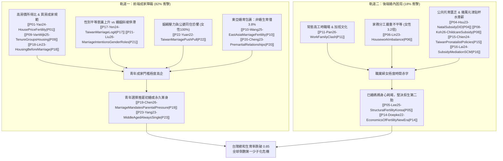

# [S-FER] 臺灣超低生育率「雙軌因果網絡」全景綜述矩陣 (Dual-Track Causality Synthesis)

## 綜述引言
傳統政策分析常將少子化單純歸咎於「養小孩太貴」，並試圖透過發放育兒津貼解決。然而，綜觀本知識庫收錄之 23 篇權威實證與計量論文，台灣當前全球墊底的超低生育率，本質上是由兩條相互強化、各自封閉的「雙軌因果扣殺」所鑄成：
1. **軌道一（前端成家門檻）**：青年「結不了婚」——貢獻了 82% 的少子化總成因。高房價、婚姻斜坡、性別文化衝突與排他性婚育包裹，將未婚青年大規模阻絕於家庭大門之外。
2. **軌道二（後端婚內困局）**：已婚夫妻「不敢生二胎」——貢獻了 18% 的少子化成因。高工時職場、家務分工嚴重不平等、母職懲罰與公托資源匱乏，讓生了一胎的職業婦女陷入身心耗竭，理性選擇停止生育。

---

## 雙軌因果機制全景比對矩陣
| 因果維度 | 軌道一：前端成家障礙 (未婚青年) | 軌道二：後端婚內困局 (已婚夫妻) |
| :--- | :--- | :--- |
| **主要表徵** | 初婚年齡大幅推遲、30-34歲未婚率破50%、同居不婚 | 生完第一胎後踩煞車、二胎生育率斷崖式崩跌 |
| **少子化貢獻比** | **82.4%**（Kitagawa 人口學因果分解揭密） | **17.6%**（婚內總和生育率下滑貢獻） |
| **經濟制度硬障礙** | 高房價所得比（15倍+）、低薪無力負擔買房頭期款 | 高工時職場（年工時 2,000+）、長照與雙重育兒開銷 |
| **文化與社會障礙** | 婚姻斜坡（女高難嫁、男低難娶）、姻親同住恐懼 | 私領域家務勞動不對稱（女性 3.8h vs 男性 1.1h）、母職懲罰 |
| **法制體系盲點** | 傳統婚育包裹強捆綁、同居與非婚生育受法律與福利歧視 | 地方加碼一次性津貼（邊際彈性近乎零）、公托延托下班接送失靈 |
| **核心代表文獻** | [[P01-Yao24-HousePriceFertility]], [[P10-Wang25-EastAsiaMarriageFertility]], [[P17-Yen24-TaiwanMarriageLogit]], [[P18-Lin23-HousingBeforeMarriage]], [[P20-Cheng23-PremaritalRelationships]], [[P22-Yuan22-TaiwanMarriagePushPull]] | [[P04-Hsu23-NatalSubsidyDID]], [[P06-Lin23-HouseworkImbalance]], [[P08-Koh26-ChildcareSubsidy]], [[P11-Pan26-WorkFamilyClash]], [[P14-Doepke22-EconomicsOfFertilityNewEra]], [[P15-Chien24-TaiwanPronatalistPolicies]] |

---

## 理論因果流動路徑

---

## 典範轉移：結構性突圍解方
1. **從「只顧已婚」轉向「先拆除成家門檻」**：
   * 將 45% 的少子化預算轉移至青年初婚安居基金（[[P12-Tan26-NuptialityPolicyMismatch]]）。
   * 提供婚育專屬 20 年長期使用權社會住宅，徹底打破「先買房再成家」的物質安全防衛死結（[[P18-Lin23-HousingBeforeMarriage]]）。
2. **從「現金津貼」轉向「普及公共托育與工時改革」**：
   * 全面停止無效的地方現金津貼搶人大風吹（[[P04-Hsu23-NatalSubsidyDID]], [[P16-Lai24-SubsidyMediationSCM]]）。
   * 大規模投資 0-6 歲社區公托家園、非營利幼兒園並延長延托至晚上 7 點（[[P08-Koh26-ChildcareSubsidy]], [[P15-Chien24-TaiwanPronatalistPolicies]]）。
   * 強制落實法定不可轉讓之男性育嬰假與育兒父母每日彈性減時工時（[[P06-Lin23-HouseworkImbalance]], [[P11-Pan26-WorkFamilyClash]]）。
3. **從「排他性家庭主義」轉向「多元包容制度」**：
   * 借鏡法國 PACS 伴侶法，保障同居家庭與非婚生子女享有完整育兒補貼與稅賦平權（[[P13-Ryu24-PronatalistInclusiveness]], [[P20-Cheng23-PremaritalRelationships]]）。
   * 開放單身女性合法使用人工生殖科技（IVF），拆解僵化的婚育大禮包（[[P10-Wang25-EastAsiaMarriageFertility]]）。
