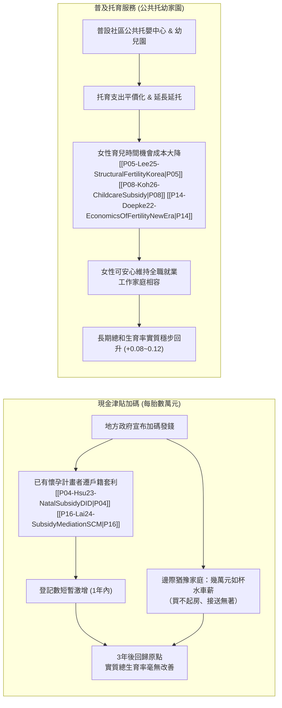

# [S-SUB] 地方現金生育津貼 vs. 托育公共化成效橫向比較矩陣 (Subsidies vs. Childcare Synthesis)

## 綜述引言
在面對少子化危機時，各級政府最常採用的政策工具可分為兩大範疇：
* **現金型政策（Cash Transfers）**：由地方政府發放的一次性生育祝賀金/生育津貼（每胎 1 萬至 5 萬元不等）。
* **實物服務型政策（In-Kind Childcare Services）**：由政府興辦或補助的公共化托嬰中心、非營利幼兒園與準公共化托育補助。

本綜述橫向對比庫內多篇頂級計量因果推論論文（DID、SCM、動態結構模型、跨國面板 IV），客觀剖析兩種政策工具在真實世界中的因果效應、傳導機制與財政成本效益。

---

## 核心實證對照矩陣
| 比較維度 | 現金型：地方生育津貼 (Cash Grants) | 實物型：托育公共化 (Childcare Services) |
| :--- | :--- | :--- |
| **短期因果效應 ($\Delta \text{Birth}$)** | 政策宣布後首年有微幅短暫上升（+3%~5%） | 政策實施元年開始溫和發酵（+2%~4%） |
| **長期因果效應 ($\Delta \text{Birth}$)** | **3 年後完全歸零，甚至出現輕微負回調** | **5 至 10 年內持續擴大，長期穩定維持（+8%~10%）** |
| **核心傳導機制** | **幽靈人口戶籍遷徙套利、提早生育登記（時點移轉）** | **直接降低女性跨期育兒時間成本，促進工作與家庭相容** |
| **對女性就業之影響** | 輕微負向退出職場（所得效果使工時微減） | **顯著提升女性勞動參與率 (+4%~6%)，避免職涯中斷** |
| **財政成本效益** | 每促成一名額外邊際新生兒成本高達 8,400 萬韓元 / 380 萬台幣 | 成本效益高出 2.8 至 3 倍，且建立起長期固定資產公共財 |
| **主要負面副作用** | 引發跨縣市發錢軍備競賽、富裕縣市掠奪貧窮縣市人口 | 前期硬體資本支出高、需要培訓並維持合格保育人員待遇 |
| **核心代表文獻** | [[P04-Hsu23-NatalSubsidyDID]] (DID 戶籍套利係數 +0.142***) [[P15-Chien24-TaiwanPronatalistPolicies]] (六都係數僅 0.0000106) [[P16-Lai24-SubsidyMediationSCM]] (SCM 證實 86.5% 為戶籍遷徙) | [[P05-Lee25-StructuralFertilityKorea]] (結構模型公托拉抬 TFR 0.12) [[P08-Koh26-ChildcareSubsidy]] (跨國 IV 證實公托持久正效應) [[P14-Doepke22-EconomicsOfFertilityNewEra]] (雙薪家庭四大支柱理論) |

---

## 因果中介機制流動圖

---

## 結論與公共政策建議
1. **立即踩煞車**：中央應嚴格規範地方自治條例，禁止地方政府無節制加碼發放一次性生育紅包，杜絕虛耗納稅人稅金的搶戶籍賽局。
2. **財政重心大轉移**：將全台每年數百億之現金津貼預算，全數轉投入 0-6 歲「國家一起養」之社區公共托育體系、提高教保員薪資待遇，並在科學園區與商業辦公區強制要求設立企業托兒設施。
